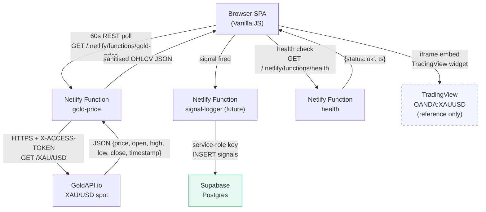

# XAU/USD Signals Platform — Architecture

> **Repair Mode**: This is an in-place repair of the existing Vanilla JS + Vite SPA. No framework migration.  
> Last updated: 2026-11-14

---

## 1. High-Level Overview

```
Browser (Vanilla JS SPA)
│
├── Signal Terminal tab      ← LW Charts + SMC overlay (live XAU/USD)
├── Strategy Library tab     ← Rule cards + heuristic descriptions
├── AI Model tab             ← Heuristic signal state machine (no ML)
├── Risk Calculator tab      ← Position sizing calculator
└── Blueprint & API tab      ← Architecture docs + endpoint reference
│
↓ 60-second REST polling
Netlify Edge (serverless functions)
│
├── /.netlify/functions/gold-price  ← fetches GoldAPI.io, returns OHLCV
└── /.netlify/functions/health      ← heartbeat, returns {status, ts}
│
↓ HTTPS
GoldAPI.io  (XAU/USD spot, free tier ~100 req/hr)
│
Supabase (nrdwfhllmahtakfvtruo.supabase.co)
└── signals table  ← signal log, server-side writes only via service key
```

---

## 2. Data Flow — Mermaid Diagram



---

## 3. Component Map

### 3.1 Frontend (browser)

| File | Role |
|---|---|
| `index.html` | Shell, tab scaffolding, CDN script tags |
| `app.js` | All runtime logic (tabs, charts, signal engine, polling) |
| `style.css` | All styling |
| `netlify/functions/gold-price.js` | Serverless proxy to GoldAPI.io |
| `netlify/functions/health.js` | Health endpoint |

### 3.2 Signal Engine (inside `app.js`)

The signal engine is **rule-based** (heuristic), not ML and not random. It operates as a state machine:

```
IDLE → WATCH → ARMED → TRIGGERED → ACTIVE → TP_HIT
                                           → SL_HIT
                                           → EXPIRED
```

| State | Condition |
|---|---|
| `WATCH` | Price within ±0.3% of a key SMC level (OB / FVG / BOS) |
| `ARMED` | Candle closes above/below level with confirming volume |
| `TRIGGERED` | Entry condition met on next candle open |
| `ACTIVE` | Trade open, monitoring TP / SL |
| `TP_HIT` | Price reached take-profit level |
| `SL_HIT` | Price reached stop-loss level |
| `EXPIRED` | 4-hour window elapsed without resolution |

### 3.3 Chart Stack

| Library | Version | Source | Role |
|---|---|---|---|
| Lightweight Charts | v4.1.3 | CDN `unpkg` | Main candlestick + SMC overlay |
| TradingView Widget | latest | `tv.js` iframe | **Reference only** — clearly labelled |

> [!IMPORTANT]  
> The LW Charts canvas uses price data from `/.netlify/functions/gold-price` only.  
> The TradingView widget is a **read-only reference** and does NOT feed the signal engine.

---

## 4. API Endpoints

### 4.1 Netlify Serverless Functions

#### `GET /.netlify/functions/gold-price`

Returns current XAU/USD OHLCV from GoldAPI.io.

**Response (200)**
```json
{
  "symbol": "XAU/USD",
  "timestamp": 1731560000,
  "price": 2645.80,
  "open": 2638.00,
  "high": 2651.20,
  "low": 2635.50,
  "close": 2645.80,
  "prev_close": 2630.10,
  "ch": 15.70,
  "chp": 0.597
}
```

**Error (502)**
```json
{ "error": "GoldAPI upstream error", "code": 502 }
```

**Rate limit**: GoldAPI.io free tier ≈ 100 req/hr. Frontend polls every **60 seconds** (≤ 60 req/hr). Safe margin maintained.

---

#### `GET /.netlify/functions/health`

Liveness check.

**Response (200)**
```json
{ "status": "ok", "ts": "2026-11-14T05:30:00Z", "version": "1.0.0" }
```

---

### 4.2 Supabase

| Resource | Value |
|---|---|
| Project URL | `https://nrdwfhllmahtakfvtruo.supabase.co` |
| Anon key | Set via `VITE_SUPABASE_ANON_KEY` env var (browser-safe) |
| Service-role key | Set via `SUPABASE_SERVICE_KEY` env var (**server-side only**, Netlify functions) |
| Auth | **Phase 1: disabled** — local-only mode. Structure present for Phase 2. |

**Table: `signals`** (Phase 1 schema)

```sql
CREATE TABLE signals (
  id          uuid DEFAULT gen_random_uuid() PRIMARY KEY,
  created_at  timestamptz DEFAULT now(),
  symbol      text NOT NULL DEFAULT 'XAU/USD',
  direction   text NOT NULL CHECK (direction IN ('LONG','SHORT')),
  state       text NOT NULL,
  entry_price numeric(10,2),
  tp_price    numeric(10,2),
  sl_price    numeric(10,2),
  confidence  numeric(5,2),
  outcome     text CHECK (outcome IN ('TP_HIT','SL_HIT','EXPIRED',NULL))
);
```

---

## 5. Environment Variables

| Variable | Used by | Description |
|---|---|---|
| `GOLDAPI_KEY` | Netlify function | GoldAPI.io API key (server-side only) |
| `VITE_SUPABASE_URL` | Browser + build | Supabase project URL |
| `VITE_SUPABASE_ANON_KEY` | Browser + build | Supabase anon/public key |
| `SUPABASE_SERVICE_KEY` | Netlify function | Supabase service-role key (never exposed to browser) |

> [!CAUTION]  
> `SUPABASE_SERVICE_KEY` and `GOLDAPI_KEY` must **never** appear in client-side bundles.  
> They are only accessible inside `netlify/functions/`.

---

## 6. Polling & Update Cadence

| Data | Method | Interval |
|---|---|---|
| XAU/USD spot price + OHLCV | REST poll → `/.netlify/functions/gold-price` | 60 seconds |
| Health check | REST poll → `/.netlify/functions/health` | 120 seconds |
| LW Charts candle | Appended on each poll tick | 60 seconds |
| Signal engine evaluation | Runs after each price update | 60 seconds |
| TradingView widget | Self-managed (iframe) | N/A |

---

## 7. Constraints & Non-Goals (Phase 1)

- **No WebSocket**: Polling only. GoldAPI.io free tier has no WS.
- **No Auth**: Supabase Auth structure present but disabled.
- **No backend signal writes**: Browser computes signals locally; Supabase writes deferred to Phase 2 (needs `signal-logger` function).
- **No random walk data**: All removed. If GoldAPI.io is unavailable, show explicit error state — no fallback fake data.
- **No PAXG/USDT proxy**: Binance crypto proxy removed entirely.
